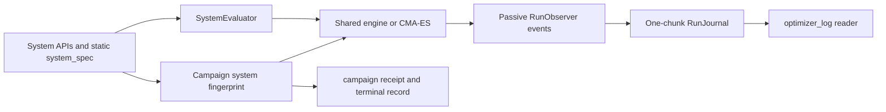

# OPTIMIZER V4.0.1 — release status

## Release identity

V4.0.1 is an independent release candidate promoted from a tested contained
commit. It uses branch `v4.0.1`, the `optimizer_v4` environment, and a
non-editable `optimizer-v4` wheel. Stable V3 and stable V4.0 remain unchanged.

The V4.0.1 release manifest binds the tag, commit, wheel hash, environment receipt,
audit report, and test evidence. Further changes belong in `contained`, not here.

## Baseline capabilities inherited from V4.0

| Area | V4 behavior |
|---|---|
| System authority | `system_spec()` declares identity, objective metric and direction, derivative target, controls, parameters, constraints, and optional capabilities. Campaign code does not assume class names, paths, `J`, or minimization. |
| Objective semantics | Gradient methods turn a declared analytical objective derivative into the common descent direction. A declared maximization therefore ascends correctly; default acceptance and selection use the system-declared metric/direction. |
| Candidate identity | Every `CandidateRef` carries a canonical `SystemReference` and SHA-256 fingerprint. A continuation/refinement validates against the candidate's producing system, not the campaign's first system. |
| Campaign durability | Campaigns write a receipt, live state, append-only timeline, and terminal state. `Campaign.open(...)` requires an explicit resolver and verifies the selected checkpoint hash before use. |
| Warm starts | Continuation and refinement transfer a standard `WarmStartState`; optimizer-private memory transfers only for the same optimizer. A changed layout/time grid requires system-owned transfer. |
| Failure/interruption | Engine and CMA-ES paths close journals with `interrupted`/`failed` lifecycle evidence and terminal-selected controls without doing a hidden new evaluation. Campaigns also write a top-level terminal failure/interruption record. |
| Feasibility | A constrained challenge cannot use generic Fourier/noise transformations. It requires the system's declared `transfer_controls(...)` hook and records its provenance. |
| Storage | The default `CheckpointPolicy` retains start, selected best, terminal/failure, and end artifacts only; all iterations remain as compact scalar events. |
| Discovery | `opt.catalog` exposes campaigns, tracker, visualization, OLGS system APIs, and log-reader surfaces in addition to optimizer methods. |

## Validation evidence

- Full suite: **136 tests passed** in **9.454 s**.
- Targeted campaign, tracker, catalog, contract, public-API, and maximization
  regressions passed after the V4 changes.
- Both contained system adapters completed compact closed-loop tracker runs:
  second-order PMP (`N=16`) and HO purification (`N=24`).  Each has a closed
  writer, no lock file, a selected-best checkpoint, and an explicit boundary
  that it is only a small tracker demonstration—not a physics result.
- `test_contained/second_order_pmp/system.py` retains the source convention
  `dt=1e-3` for the real default problem.  The small `N=16` tracker grid is not
  a replacement for that source experiment.

## Deliberate limits before final promotion

1. A campaign reopens only with a caller-owned system resolver/factory.  V4
   refuses to reconstruct a scientific system from a guessed import path.
2. Checkpoint retention is bounded, but V4 has no destructive garbage collector
   yet.  A future cleanup tool must build a reference graph and show a dry run.
3. The generic library exposes reader/index primitives, not a production web UI
   or autonomous campaign policy.
4. System-owned `transfer_controls(...)` declares how a constrained perturbation
   remains feasible; V4 does not pretend it can prove a physics constraint from
   generic array operations.
5. Contained adapter runs are functional integration checks only.  Any research
   result still needs the original system resolution, declared parameters,
   derivative verification, and the relevant physical validation campaign.

## Release gate

This tagged checkout is immutable. A future release must select a specific contained
commit, create a new clean candidate checkout, install a wheel in a fresh release
environment, and repeat the independent audit.
